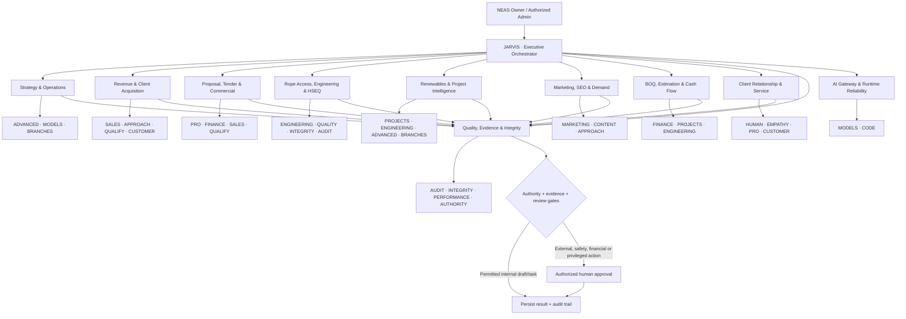
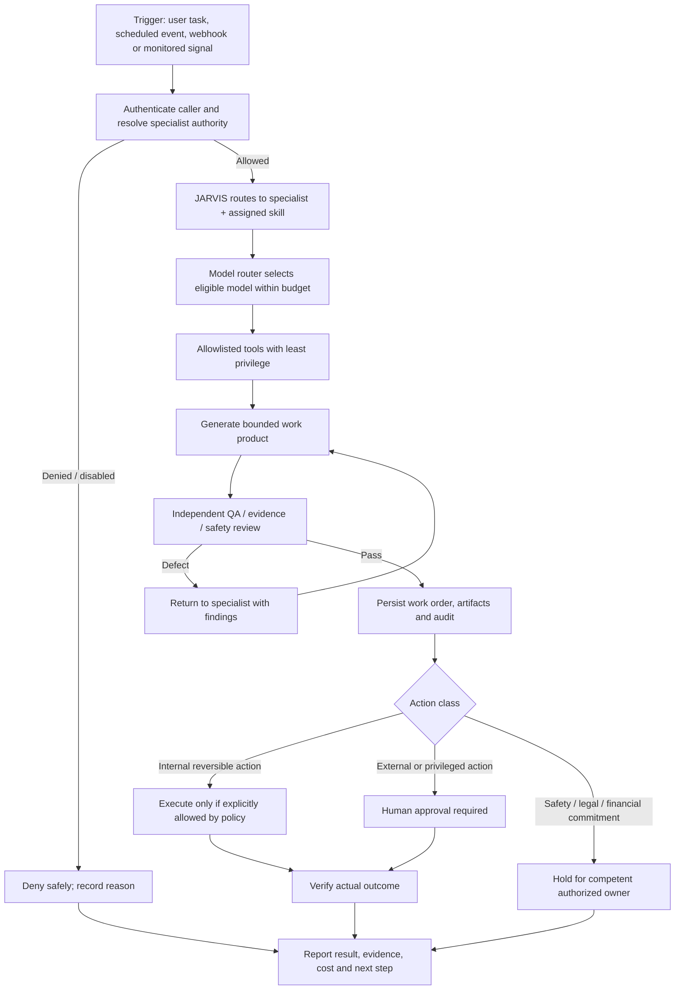
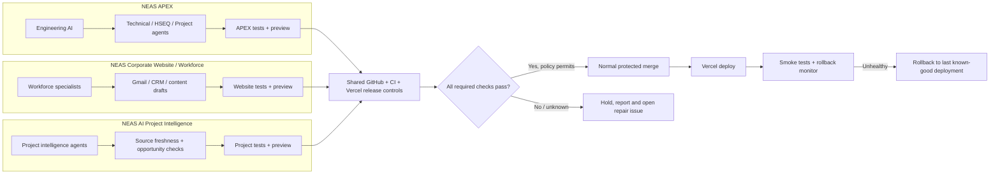

# NEAS AI Workforce — Agent Architecture & Automation Diagrams

Status: architecture specification derived from the current workforce skill registry and command-center department definitions. This document does not claim that every automation described here is already deployed.

## 1. Verified specialist roster

The current skill-registry test enumerates 23 specialist IDs:

`JARVIS`, `SALES`, `MARKETING`, `CONTENT`, `SKILLS`, `PERFORMANCE`, `AUTHORITY`, `APPROACH`, `HUMAN`, `EMPATHY`, `PRO`, `ENGINEERING`, `QUALIFY`, `QUALITY`, `INTEGRITY`, `ADVANCED`, `MODELS`, `BRANCHES`, `CODE`, `FINANCE`, `CUSTOMER`, `PROJECTS`, `AUDIT`.

The registry currently maps these agents to nine reusable skill lanes. A separate specialist identity does not imply a separate permission grant: the saved server-side authority matrix remains the source of truth.

## 2. Executive orchestration and agent topology

## 3. Individual agent skill assignments

| Agent ID | Assigned skill lane | Primary automation responsibility |
|---|---|---|
| JARVIS | Executive orchestration | Decompose objectives, assign owners, track dependencies and consolidate status |
| SALES | Revenue & client acquisition; proposal commercial | Qualify opportunities, prepare CRM updates and proposal inputs |
| MARKETING | Marketing & demand generation | SEO briefs, campaign plans and channel content drafts |
| CONTENT | Marketing & demand generation | Produce evidence-based content drafts and asset briefs |
| SKILLS | Workforce knowledge / skill operations | Maintain skill inventory, coverage checks and skill-test reporting; changes require review |
| PERFORMANCE | Quality, evidence & integrity | Measure agent quality, SLA, completion and rework indicators |
| AUTHORITY | Quality, evidence & integrity | Check saved permissions and deny actions outside authority |
| APPROACH | Revenue & client acquisition; marketing | Draft buyer-specific outreach and campaign angles; never send without authorization |
| HUMAN | Client relationship & service | Prepare human-centered client response and service-recovery drafts |
| EMPATHY | Client relationship & service | Tone, sensitivity and customer-impact review |
| PRO | Proposal commercial; client relationship | Proposal quality and client-facing document review |
| ENGINEERING | Rope access, HSEQ; renewables; estimation | Technical work-pack drafts, engineering scope and estimate inputs |
| QUALIFY | Revenue; proposal commercial | Bid/no-bid and lead qualification evidence |
| QUALITY | Rope access, HSEQ | QA plans, inspection evidence and quality review checklists |
| INTEGRITY | HSEQ; quality and governance | Evidence integrity, factuality and conflict review |
| ADVANCED | Executive orchestration; renewables | Strategic analysis and project intelligence |
| MODELS | Executive orchestration; AI gateway reliability | Model routing, health and cost diagnostics |
| BRANCHES | Executive orchestration; renewables | Branch coordination, project ownership and workstream handoffs |
| CODE | AI gateway reliability | Reproduce defects, implement tested code fixes on isolated branches |
| FINANCE | Proposal commercial; estimation and cash flow | BOQ, margin, payment-risk and cash-flow analysis |
| CUSTOMER | Revenue; client relationship | Customer qualification, relationship history and service follow-up drafts |
| PROJECTS | Renewables; estimation and cash flow | Project lifecycle, schedule, delivery risk and resource planning |
| AUDIT | Technical HSEQ; governance | Independent evidence, compliance and audit review |

## 4. Agent work-order automation lifecycle

## 5. Per-agent automation catalogue

All agents may perform their permitted internal read, analysis, draft, classification, summarization and reporting tasks automatically when enabled in the saved authority matrix. The following are the agent-specific recurring or event-driven jobs to implement:

| Agent | Trigger | Automated job | Completion evidence |
|---|---|---|---|
| JARVIS | New objective / daily queue | Decompose, assign, prioritize, detect blocked work and issue executive brief | Workstream IDs, owners, dependencies, status |
| SALES | New lead / CRM stage change | Score fit, identify missing qualification fields, recommend next action | Lead score and sourced evidence |
| MARKETING | Weekly campaign cycle | Generate SEO/content calendar and conversion experiment drafts | Approved content brief and KPI baseline |
| CONTENT | Approved content brief | Draft platform-specific copy, captions and metadata | Draft artifact and factuality checklist |
| SKILLS | Agent or skill registry change | Check every enabled agent has a valid skill and tests | Registry coverage report and passing tests |
| PERFORMANCE | Daily / weekly | Calculate task completion, latency, rework and quality trends | KPI snapshot with source window |
| AUTHORITY | Every tool invocation / config change | Enforce enabled state, role level, least privilege and deny-by-default | Authorization decision and audit event |
| APPROACH | Qualified lead / campaign brief | Draft personalized, sourced outreach variants | Draft only; no send action |
| HUMAN | Customer event / complaint | Prepare response options and service recovery plan | Draft, owner and follow-up date |
| EMPATHY | Before customer-facing draft | Review tone, clarity, impact and sensitive-data minimization | Review findings |
| PRO | Proposal or customer document ready | Check completeness, consistency, unsupported promises and readability | QA checklist and unresolved items |
| ENGINEERING | New technical scope / asset record | Create draft scope breakdown, document checklist and review hold points | Technical draft with competent-person gates |
| QUALIFY | New RFQ / lead | Run bid/no-bid and qualification matrix | Evidence-linked qualification decision |
| QUALITY | Inspection / delivery milestone | Check ITP, inspection records, nonconformances and closeout completeness | Quality evidence register |
| INTEGRITY | Before release of any specialist output | Challenge claims, arithmetic, source quality, privacy and conflicts | Severity-ranked findings and retest |
| ADVANCED | Weekly strategy cycle / new project signal | Produce scenario and opportunity analysis | Assumptions, sources and recommendations |
| MODELS | Scheduled runtime check / model error | Check eligible models, latency, failure rates and budget headroom | Side-effect-free health report |
| BRANCHES | New opportunity / project handoff | Identify regional owner, local dependencies and handoff status | Branch assignment and handoff record |
| CODE | CI failure / confirmed defect | Reproduce, branch, patch, test and open PR | Commit SHA, regression test and CI evidence |
| FINANCE | New BOQ / invoice / payment milestone | Recalculate cost, margin, collections and cash exposure | Traceable calculation and assumptions |
| CUSTOMER | Customer reply / stage change | Summarize history and prepare next response/follow-up draft | Draft and CRM recommendation |
| PROJECTS | Project milestone / schedule variance | Update schedule risks, resource constraints and recovery options | Milestone variance report |
| AUDIT | Release / audit event / periodic review | Sample evidence, permissions, approvals and control exceptions | Findings, severity and closure evidence |

## 6. Three-site engineering automation

## 7. Automation guardrails

- Preserve the existing per-specialist authority matrix. A new diagram, skill, or automation does not grant permissions.
- Keep specialist work orders in `needs_review` unless the saved policy explicitly permits a narrowly scoped internal action.
- No autonomous customer email sending, social publishing, ad spend, quotations, contracts, purchases, payments, mobilization, engineering certification, permit approval, or HSE sign-off.
- No production secrets, OAuth credentials, API keys or customer message bodies in logs or commits.
- No force-push, direct protected-branch push, admin merge override, review dismissal, branch-protection bypass or skipped required checks.
- Auto-merge only under normal repository rules after every required CI/security/review gate passes and Vercel preview is healthy.
- Production deploy only through the configured protected release path. Verify deployment health and roll back on a confirmed regression.
- Destructive database/schema changes, permission changes, auth changes, provider credential changes and budget increases remain blocked for explicit authorized review.
- Never report a planned automation as active until its workflow/schedule is installed and a successful run is observed.

## 8. Implementation acceptance checklist

1. Verify all 23 agent IDs against the runtime registry and saved database configuration.
2. Verify each agent resolves to exactly one primary skill or a documented multi-skill assignment.
3. Verify disabled, observe-only and missing-authority agents fail closed.
4. Add tests for every agent-to-skill mapping and action boundary.
5. Add event/schedule definitions only after verifying the supported runtime, idempotency, retry policy and audit sink.
6. Verify every automation has owner, trigger, permissions, timeout, retry cap, budget cap, failure queue and observability.
7. Test each workflow in preview with mocked external side effects.
8. Verify GitHub checks and Vercel preview before merge; use normal branch protections.
9. Verify production health and rollback path after deployment.
10. Report which automations are implemented, enabled, tested and still blocked; never conflate these states.
