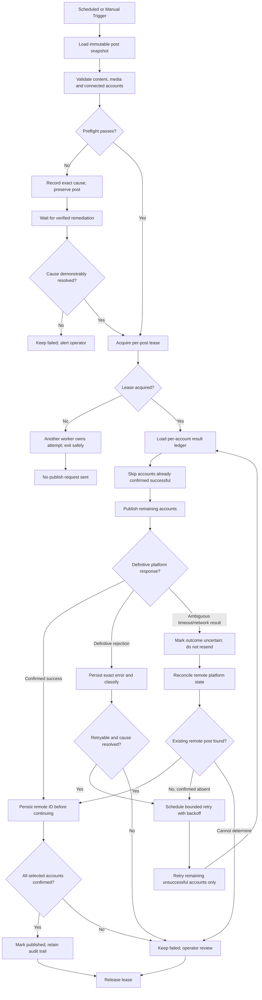

# NEAS Auto Publishing Recovery

## Production invariants

1. A post is not `published` until every selected platform/account has a confirmed success and a remote post ID (or a documented platform response that is the platform's success identifier).
2. A successful account result is immutable for retry purposes: never send that account's post again.
3. A failed or uncertain post remains in the database with its original title, body, platform selection, media reference, and error history.
4. A retry is permitted only after the diagnosed cause is demonstrably resolved.
5. A timeout or connection loss after a publish request is an **ambiguous outcome**, not proof of failure. Do not automatically resend it; reconcile against the platform or require operator review to avoid duplicate publication.
6. All publish entry points (manual, scheduled, recovery) must use the same per-post lock and per-account success ledger.
7. Retries are bounded, delayed with backoff, and observable. Exhausted or non-retryable attempts require operator action.

## State flow

## Error policy

| Class | Examples | Automatic action |
|---|---|---|
| Preflight / configuration | Missing account, expired OAuth, permission revoked, missing media | Do not publish. Preserve error; wait until account/content check proves the issue is fixed. |
| Definitive transient rejection | Explicit rate-limit response with retry guidance | Retry only after the retry window and a successful preflight; apply bounded exponential backoff. |
| Permanent rejection | Invalid media, unsupported format, invalid payload, policy/permission rejection | Do not retry unchanged input. Preserve the post and request correction/reconnection. |
| Ambiguous outcome | Request timeout, connection reset, upstream 5xx after request submission | Never blind-retry. Reconcile platform state first; otherwise require operator review. |
| Confirmed success | Platform success response with remote ID | Persist immediately and permanently skip that account on subsequent attempts. |

## Retry schedule

- Maximum automatic retries: 3 per account, after a definitive retryable response only.
- Backoff: 1 minute, 5 minutes, then 20 minutes, subject to any longer platform-provided retry window.
- A successful preflight is required immediately before each retry.
- A changed post body or media reference must create a new content revision/audit event and invalidate any prior retry decision.
- Manual override must be an explicit manager action and must never bypass the per-post lock or successful-account ledger.

## Required observability

For every attempt, retain post ID, account ID, platform, attempt number, trigger type, start/end time, outcome class, exact provider error, remote ID, retry eligibility, next retry time, and lock owner. Never log access tokens or secrets.

## Current implementation status

The current pull request adds the per-post database lease and additive migration. Existing code already skips accounts with successful ledger entries and marks the overall post published only when all selected platform results are successful. The automatic recovery queue, error classifier, ambiguous-outcome reconciliation, bounded retry scheduler, and dashboard visibility are not yet implemented. Do not enable unattended retries until those components and staging tests are complete.
